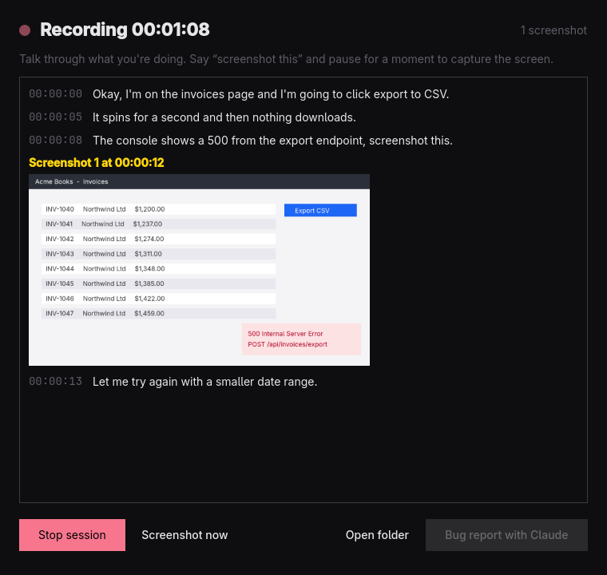

# Debrief



Debug out loud. Debrief records your voice while you work, transcribes it a
sentence at a time, and takes a screenshot of the whole screen whenever you say
**"screenshot this"**. Each screenshot is tied to the words you said around it,
so the session folder reads as a story Claude can turn into a bug report.

## Using it

1. Start a session: press Space in the window, click the bug in the Omarchy bar,
   or run `debrief start`. The window can stay closed; the bar icon turns red
   while recording.
2. Talk through what you're doing. When something is worth capturing, say
   "screenshot this" (or "screen shot that", "take a screenshot") and pause for
   a moment. The screen is captured the moment you stop talking and kept only if
   your words asked for it.
3. Stop the session from the window, the bar, or `debrief stop`. Debrief
   finishes transcribing the last sentences, then saves the session.
4. Press B (**Bug report with Claude**) to open Claude Code in the session
   folder with a prompt that reads the transcript, looks at every screenshot,
   and writes `bug-report.md`.

Each session is a folder under `~/Documents/Debrief/`:

```text
2026-11-13_10-55-04/
  audio.wav        the whole session, 16 kHz mono
  transcript.md    time-coded transcript, each screenshot embedded under its words
  session.json     the same for agents: screenshots[].transcript_index, said, context
  screenshots/     shot-01-00-03-12.png, ...
```

Transcription runs locally through [Superwhisper](https://superwhisper.com)'s
offline models, so it needs Superwhisper installed. Without it Debrief still
records audio and takes screenshots by hand (S), and says so in the window.

## Keyboard

| Key   | Action                          |
|-------|---------------------------------|
| Space | Start or stop a session         |
| S     | Take a screenshot now           |
| O     | Open the session folder         |
| B     | Write a bug report with Claude  |
| ?     | Show or hide the shortcuts      |
| Q     | Quit (asks first while recording) |

Closing the window doesn't stop a session; the bar shows it's still recording.

## Bar widget

```bash
debrief bar install     # links the widget into ~/.config/omarchy/plugins and adds it to the bar
debrief bar remove
```

Left click starts or stops a session, right click opens Debrief, and middle
click opens the session folder.

## Command line

```bash
debrief start | stop | toggle    # drive the session; start launches Debrief if needed
debrief shot                     # screenshot now, e.g. from a key binding
debrief status --json
debrief prompt                   # the bug-report prompt the B button uses
debrief skill install            # a Claude Code skill describing the session format
```

Commands exit 0 or 1, report errors on stderr, and take `--json`.

## Building

```bash
bin/build                                 # into build/
bin/test                                  # build, then run the tests offscreen
cmake --install build --prefix ~/.local   # try it in the app launcher
```

It needs Qt 6 (base, declarative, svg, wayland), ffmpeg, grim, and Superwhisper
for transcripts.
